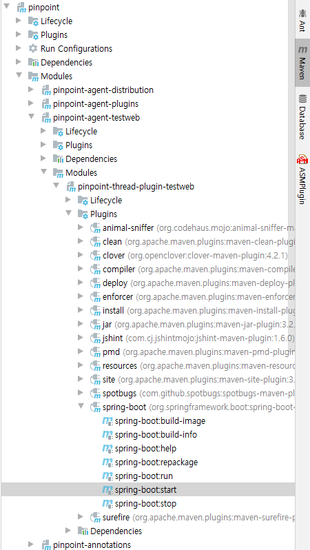

## Agent Testweb
Pinpoint-agent sample app

## Prerequirements
[Install pinpoint](../doc/installation.md#quick-overview-of-installation) and start [pinpoint-web](../web/README.md) and [pinpoint-collector](../collector/README.md)

## Sample App
[ThreadPlugin-Test](thread-plugin-testweb/README.md)

## Using CLI
The sample apps attach `agent-module/agent/target/pinpoint-agent-<version>/pinpoint-bootstrap.jar`, so build the agent
distribution first. Then select a sample app by its module path.

```
$ ./mvnw install -pl agent-module/agent -am -Dmaven.test.skip=true
$ ./mvnw install -pl agent-module/agent-testweb/<sample-app> -am -Dmaven.test.skip=true
$ ./mvnw -pl agent-module/agent-testweb/<sample-app> spring-boot:start
$ ./mvnw -pl agent-module/agent-testweb/<sample-app> spring-boot:stop
```

## Using IDE
When running the sample app in IDE, use the built-in maven feature

eg) IDEA

Maven-tab > $SAMPLE_APP > Plugins > spring-boot:start



